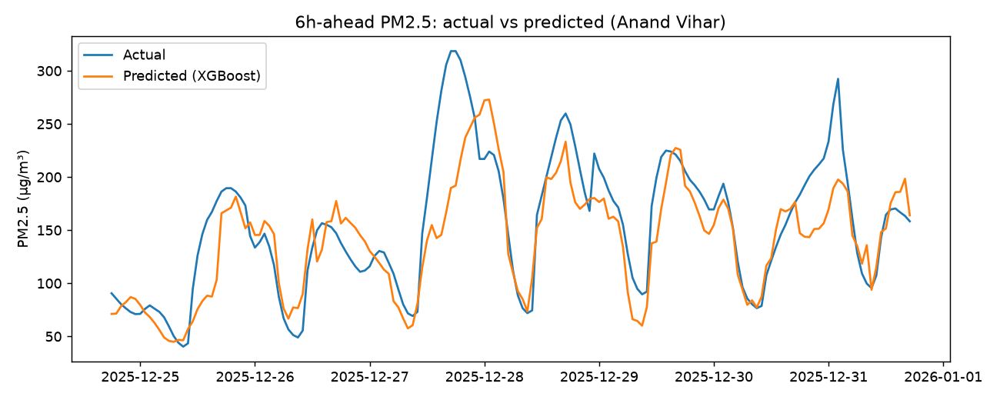
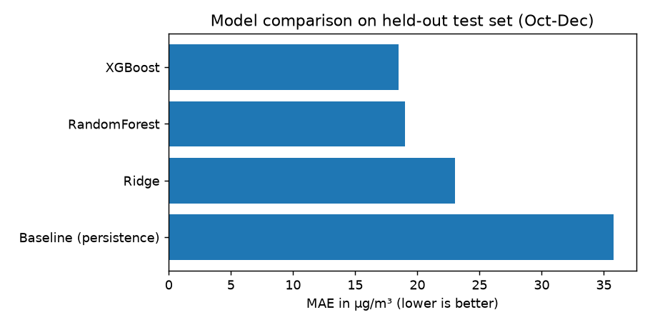

# 🌫️ Delhi Air Quality Forecaster

Predicts **PM2.5 six hours ahead** for six Delhi stations (Anand Vihar, Connaught Place,
Dwarka, IGI Airport, Okhla Phase III, Rohini) from weather and recent pollution history,
and serves it through a Streamlit app.

**Live demo:** _<add your Streamlit Cloud link here>_



## Results

Time-based split: trained on Jan–Sep 2025, tested on Oct–Dec 2025 (winter, a harder regime
than anything in training).

| Model | MAE (µg/m³) | RMSE (µg/m³) |
|---|---|---|
| Baseline (persistence: "same as now") | 35.8 | 50.4 |
| Ridge | 23.0 | 32.8 |
| Random Forest | 19.0 | 27.3 |
| **XGBoost** | **18.5** | **26.6** |

XGBoost cuts error by about 48% versus the persistence baseline.



## Approach

1. **Data:** hourly weather + air quality, 6 stations, 52,560 rows (full year 2025).
2. **EDA:** PM2.5 peaks in December and is lowest in September; within a day it peaks late
   evening (~22:00) and is lowest mid-afternoon (~15:00). Temperature has a mild negative
   correlation with PM2.5. See `eda.py` and `assets/`.
3. **Features** (built per station, no cross-station leakage): current pollutants and weather,
   PM2.5 lags (1/3/6/12/24h), rolling means (6h/24h), cyclical hour encoding, day of week,
   station one-hot.
4. **Target:** the *change* in PM2.5 over the next 6 hours (added back to the current value).
   Predicting raw PM2.5 fails on the winter test period because tree models cannot
   extrapolate beyond the range seen in training.
5. **Evaluation:** strictly time-based split, compared against a naive baseline.

## Findings and limitations (honest notes)

- **24h-ahead did not beat the baseline.** With one year of data, the model cannot learn how
  winter behaves from summer-heavy training data, and "same hour tomorrow" is already strong
  because of the daily cycle. I therefore scoped the product to a 6h horizon, where the model
  clearly adds value. More years of data would likely fix this.
- **Pollutant values are identical within two station groups** (Anand Vihar / Connaught Place /
  Rohini, and Dwarka / IGI Airport / Okhla), which suggests gridded model data rather than
  independent ground sensors. Effectively there are two pollution series, not six.
- A few AQI values exceed 500 (max 2742), which is outside the standard scale, so the model
  targets **PM2.5** and categories use CPCB PM2.5 breakpoints.
- The app replays historical data (no live API), so it demonstrates the model rather than
  serving live forecasts.

## Run locally

```bash
python -m venv venv
venv\Scripts\activate          # Mac/Linux: source venv/bin/activate
pip install -r requirements.txt
python eda.py                  # optional: regenerate EDA plots
python train.py                # trains models, saves models/model.pkl
streamlit run app.py
```

## Project structure

```
├── data/                 # raw CSV
├── models/               # trained model + metrics.json
├── assets/               # plots used in this README
├── features.py           # loading + feature engineering (shared)
├── train.py              # training + evaluation
├── eda.py                # exploratory plots
├── app.py                # Streamlit app
└── requirements.txt
```

## Tech stack
Python, pandas, scikit-learn, XGBoost, Streamlit, matplotlib.
